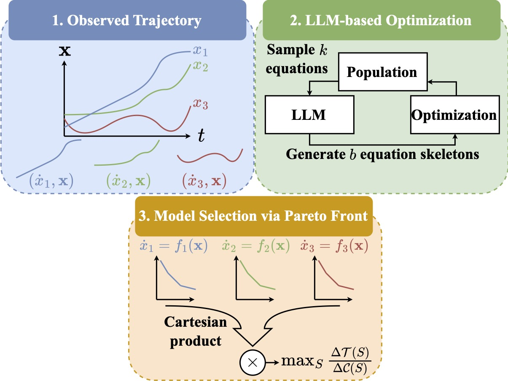
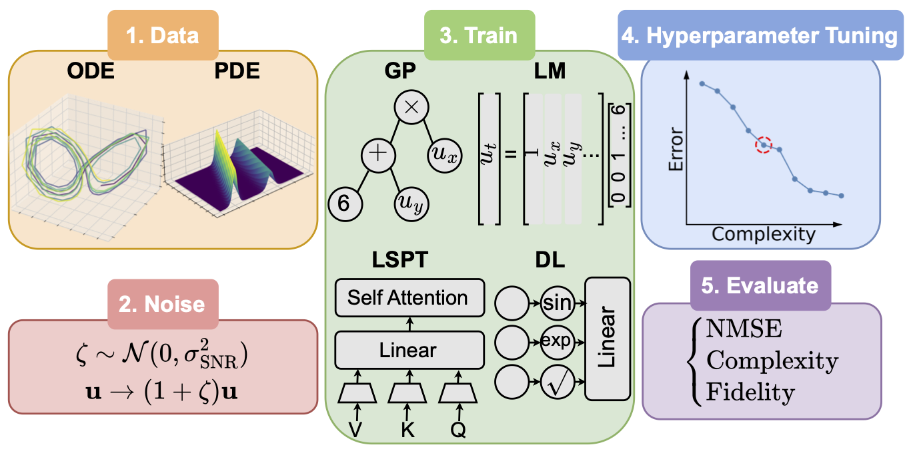
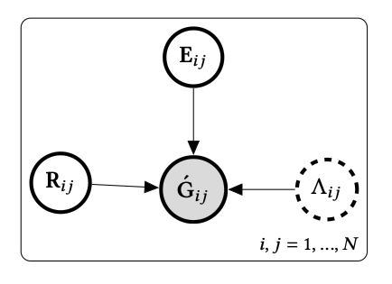
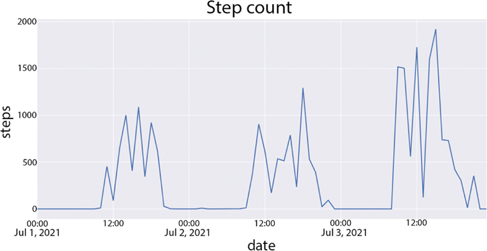
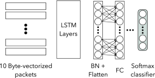

# About

Hi! I am a second-year PhD student in Computer Science at the [City University of New York](https://www.gc.cuny.edu/computer-science), advised by Prof. [Savannah Thais](https://www.hunter.cuny.edu/people/savannah-thais/). Prior to that I worked as a Software Engineer at [Nokia](https://www.nokia.com). I earned my MSc in Complex Systems from Aalto University's [Department of Computer Science](https://www.aalto.fi/en/department-of-computer-science) and my BSc in Computer Engineering from Sharif University of Technology's [Computer Engineering Department](https://ce.sharif.edu/).

Research Interests:
- Symbolic Regression, Equation Discovery, Scientific ML
- AI Safety
- Representation Learning, Embedding Models

I am happy to discuss research ideas and to collaborate! Please reach me at [amir_zia@outlook.com](mailto:amir_zia@outlook.com).

# News

- **[Jul 2026]** I joined [Backbase](https://www.backbase.com) as a summer PhD AI Research Intern, working on representation learning and dense retrieval models on banking data.
- **[Jul 2026]** Our [work](https://aclanthology.org/2026.clpsych-1.35/) was accepted at CLPsych, an ACL 2026 workshop.
- **[Apr 2026]** I held a workshop on making reproducible and visible research at The Graduate Center, CUNY. Check out the materials [here](https://github.com/amirzia/research-workshop/tree/main).
- **[Apr 2026]** LLM-ODE paper accepted at [GECCO-26](https://gecco-2026.sigevo.org/HomePage)!
- **[Nov 2025]** MDBench paper accepted for an oral presentation at AAAI 2026!
- **[Sep 2025]** New preprint is available: [MDBench: Benchmarking Data-Driven Methods for Model Discovery](https://arxiv.org/abs/2509.20529)

# Publications | [Google Scholar](https://scholar.google.com/citations?user=znk2PcgAAAAJ&hl=en)

| [CUNY at CLPsych 2026: A Pipeline Approach to Classification and Summarization   of Mental Health Change](https://aclanthology.org/2026.clpsych-1.35/)   **Amirmohammad Ziaei Bideh**, Shameed Job, Ava Yahyapour, Alla Rozovskaya   *CLPsych Workshop at ACL 2026*   <a href="https://github.com/amirzia/clpsych26-cuny" style="color: #e74c3c;">Code</a> |  |
| [LLM-ODE: Data-driven Discovery of Dynamical Systems with Large Language Models](https://arxiv.org/abs/2603.20910)   **Amirmohammad Ziaei Bideh**, Jonathan Gryak   *GECCO 2026*   <a href="https://github.com/gryaklab/llm-ode" style="color: #e74c3c;">Code</a>, <a href="https://gryaklab.github.io/llm-ode/" style="color: #e74c3c;">Website</a> |       |
| [MDBench: Benchmarking Data-Driven Methods for Model Discovery](https://arxiv.org/abs/2509.20529)   **Amirmohammad Ziaei Bideh**, Aleksandra Georgievska, Jonathan Gryak   *AAAI 2026*   <a href="https://github.com/gryaklab/mdbench" style="color: #e74c3c;">Code</a>, <a href="https://zenodo.org/records/17611099/" style="color: #e74c3c;">Dataset</a> |       |
| [Joint Inference of Diffusion and Structure in Partially Observed](https://doi.org/10.1145/3599237)   Social Networks Using Coupled Matrix Factorization   Maryam Ramezani, Aryan Ahadinia,   **Amirmohammad Ziaei Bideh**, Hamid R Rabiee   *ACM Transactions on Knowledge Discovery from Data, 2023*|       |
| [Niimpy: A toolbox for behavioral data analysis](https://doi.org/10.1016/j.softx.2023.101472)   Arsi Ikäheimonen, Ana M. Triana, Nguyen Luong,   **Amirmohammad Ziaei Bideh**,   Jarno Rantaharju, Richard Darst, Talayeh Aledavood   *SoftwareX, 2023*   <a href="https://github.com/digitraceslab/niimpy" style="color: #e74c3c;">Code</a>  |      |
| [Machine learning interpretability meets TLS fingerprinting](https://doi.org/10.1007/s00500-023-07949-9)   Mahdi Jafari Siavoshani, Amirhossein Khajehpour,   **Amirmohammad Ziaei Bideh**, Amirali Gatmiri & Ali Taheri   *Soft Computing, 2023*  |  |

# Teaching

- Instructor, "An Introduction to LLMs and AI Agents", Queens College, Summer 2026.

# Personal Interests

Stay tuned for my portrait photography project based in New York City!

 
 
